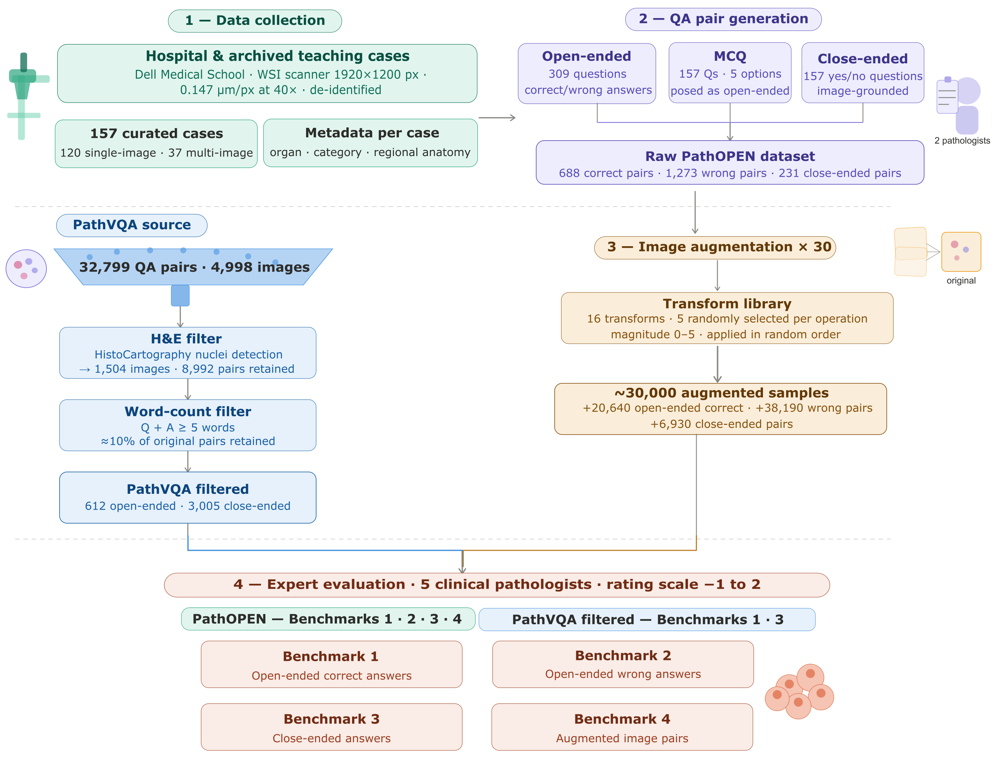

# PathOPEN

A pathologist-curated visual question answering dataset for histopathology, and the
full pipeline that builds, augments, evaluates and validates it.

157 cases curated by two clinical pathologists, each with 1–3 H&E images at up to five
magnifications, open-ended questions with **both correct and wrong answers**, one
five-option MCQ, and one close-ended question. Five further pathologists rated the
result against four scoring rubrics. The dataset is accompanied by a 30× augmented
variant and a class-balanced retention variant.

The accompanying manuscript is being prepared for *Scientific Data* as a Data
Descriptor. **The manuscript source is not in this repository** - it lives with the
corresponding author. §7 lists the issues in the current draft that still need fixing.

---

## 1. Orientation — read this first

The repository is organised as **pipeline stages**, each a top-level directory, in the
order data flows through them:

```
data_processing/     raw collection -> structured JSON; PathVQA H&E filtering
data_augmentation/   30x transform pipeline; class-balanced retention variant
data_analysis/       descriptive statistics of the raw datasets
data_evaluation/     the evidence: pathologist ratings, VLM judges, VLM answerers
data_graphics/       publication figures and LaTeX tables
pathopen_data/       the dataset itself (gitignored - see §6)
```

Two rules that explain most of the layout:

**Generated output is never committed.** Every directory that holds results —
`output/`, `analysis/`, `checkpoints/`, `figures/`, `tables/` — is gitignored. The
*code* is tracked; the outputs are reproduced by running it. See `.gitignore` for the
complete list. This means a fresh clone has no results in it, and you must re-run the
pipeline to get them.

**Several subdirectories carry their own README**, and those are the authoritative
detail for their stage. This file is the map; they are the territory:

| README | Covers |
|---|---|
| `data_evaluation/vlm_judge/README.md` | Judge pipeline, the five rubrics, checkpoint invariant |
| `data_evaluation/vlm_zeroshot/README.md` | Answerer pipeline, the six-model set, metrics |
| `data_evaluation/vlm_zeroshot/ENVIRONMENT.md` | **Why two conda environments are required** |
| `data_graphics/README.md` | Figure conventions, Nature sizing, table generation |

---

## 2. Environment

```bash
conda activate path-opendata-vlms
```

**Use this environment, not system Python** — the base interpreter lacks matplotlib and
the scientific stack. Nearly every script and notebook here assumes it.

A **second environment, `path-llava`**, exists solely for LLaVA-Med and Quilt-LLaVA.
Those two are original-LLaVA-repo checkpoints whose dependencies would downgrade the
stack the other four models and both judges need. `ENVIRONMENT.md` explains the
conflict and the `LD_LIBRARY_PATH` workaround; don't try to merge the two.

GPU work (judges, answerers) expects multiple CUDA devices; `gpu_allocation.py` in both
evaluation folders handles placement.

---

## 3. The pipeline, stage by stage

### 3.1 `data_processing/` — raw data to structured records

| File | Role |
|---|---|
| `raw_pathopen_data_processing.ipynb` | Google Form responses + images → `pathopen_data/processed/data.json` |
| `raw_pathvqa_data_filtering_histocartography.ipynb` | Filters PathVQA to H&E-stained images |
| `histocartography/` | Vendored dependency (gitignored) |

**The PathVQA filter is a three-step funnel**, and the numbers matter because the paper
quotes them:

1. **H&E detection** — HistoCartography nuclei detection; an image is kept if it has
   **more than 10 nuclei** (`nuclei_centers.shape[0] > 10`). → 1,241 images, 8,992 pairs
   from the original 4,998 images / 32,799 pairs.
2. **Question-type split** — "yes/no" answers are close-ended, the rest open-ended.
   → 4,630 close-ended, 4,362 open-ended.
3. **Word-count floor** — both question and answer must have ≥ 5 words (close-ended:
   question only). → **612 open-ended, 3,005 close-ended**, about 10% of the original.

> ⚠️ A stale comment above the nuclei line mentions 5 neighbours (a kNN parameter). The
> threshold is 10. The manuscript's §2.8 currently says 5 and is wrong; §3.5.2 says 10
> and is right.

### 3.2 `data_augmentation/` — scaling and rebalancing

| File | Role |
|---|---|
| `raw_pathopen_data_augmentation.ipynb` | Applies the 30× transform pipeline |
| `targeted_augmentation_balance.ipynb` | Class-balanced retention variant, entropy/Gini |
| `pathology-he-autoaugmetation/` | Vendored augmentation library (gitignored) |

**The 30× pipeline.** Each original image gets 30 augmentations. One augmentation =
5 transforms drawn at random from 16, each at a random magnitude 0–5, applied in random
order on top of one another. Elastic deformation, Gaussian blur and Gaussian noise are
**deliberately excluded** — pathologists judged they destroy identifiability at higher
magnitudes.

Setup for the vendored library:

```bash
git clone git@github.com:DIAGNijmegen/pathology-he-autoaugmetation.git
pip install scikit-image albumentations==1.1.0
```

Then edit `randaugment/train/randaugement_new_ranges.py`:
- `_REPLACE = 225` — makes background semi-white to match slide background
- `available_ops = ['Scaling','TranslateX','TranslateY','ShearX','ShearY','Brightness',
  'Sharpness','Color','Contrast','Rotate','Equalize','HsvH','HsvS','HsvV','HedH','HedE','HedD']`

**The balanced variant is a *selection*, not a second generation run.** This is the
single most misunderstood part of the repo. All 30 augmentations per image stay on disk.
`targeted_augmentation_balance.ipynb` computes, per image, how many of its existing 30 to
*retain* so a chosen metadata field's class distribution flattens:

```
keep = clip(n_max / n_class, 1, MAX_MULTIPLIER=10), further capped by what exists
```

A rare-class image keeps up to 10; a common-class image keeps 1. The output is a
**manifest** in `pathopen_data/augmented/balanced_manifests/` naming which files a
training run should consume — not a folder of copies.

Consequences worth knowing:
- Each of the four fields is balanced **separately**, giving four different variants of
  852 (Organ) / 988 (Categorization) / 994 (Regional Anatomy) / 427 (Magnification)
  images. Regional anatomy nests inside organ, so balancing one perturbs the others.
  There is no single variant that flattens all four.
- **Magnification is not one of the paper's three stated fields** (§3.5 names organ,
  categorization, regional anatomy). It is balanced anyway because it is imbalanced on
  the same order (10.4× ratio) and, unlike the other three, is a property of the *image*
  rather than the *case* — so balancing it leaves case-level representation untouched and
  composes with the others. Note the notebook's own justification for including it cites
  "augmented 400× images rated lowest by every rater", which is **false for Qwen**, whose
  minimum is 20×. The inclusion is defensible on imbalance grounds; that sentence is not.
- `MAX_MULTIPLIER = 10` is an **overfitting guard**, chosen for that reason. The
  multiplier sweep confirms it captures most of the available correction; it did not
  select it.
- Uniform 30× augmentation leaves Gini and entropy **exactly** unchanged, because
  scaling every class by a constant cannot change class proportions. This is arithmetic,
  not measurement, and it is why differential retention is needed at all.

Outputs → `augmentation_balance_output/`: `pillar5b_balance_before_after.csv`,
`pillar5b_class_counts.csv`, `pillar5b_multiplier_sweep.csv`,
`figure10b_magnification_quality.csv`, `figure10b_magnification_trend.csv`.

### 3.3 `data_analysis/` — descriptive statistics

`raw_pathopen_data_analysis.ipynb` and `raw_pathvqa_data_analysis.ipynb` produce the 29
PNGs in `output/`: word-count distributions and thresholds, organ / categorization /
regional-anatomy / magnification breakdowns.

These describe the *dataset*. The `data_graphics/` figures report the *evaluation*. Don't
confuse the two sets — they serve different manuscript sections (Data Records vs.
Technical Validation).

### 3.4 `data_evaluation/` — the evidence

Three independent evaluation tracks. **Understanding the judge/answerer distinction is
essential**:

| | `vlm_judge/` | `vlm_zeroshot/` |
|---|---|---|
| model's job | grade existing text against a rubric | produce an answer |
| output | ordinal score {−1,0,1,2} | predicted option / free text |
| metric | weighted κ, Gwet's AC1 vs pathologists | accuracy, token F1, BLEU, chrF, BERTScore |
| models | 2 large judges (32B / 38B) | 6 candidates (4–8B) |

#### `pathologists/` — the human ground truth

`subsets_processing/` builds the rating packets handed to the five pathologists;
`scoring_analysis/` aggregates what came back. Each subset has an `_individual` and a
`_final` notebook (per-rater vs pooled).

**Each item was rated by exactly one pathologist.** There is zero overlap, so no
per-item inter-rater statistic (Fleiss' κ, Krippendorff's α) is computable on this
design. What *can* be tested is whether raters' score **distributions** differ —
χ² and Kruskal–Wallis — which is what the analysis does.

#### `vlm_judge/` — VLM replaces pathologist

InternVL3.5-38B and Qwen3-VL-32B-Thinking score text against the same rubrics the
pathologists used. Rubric text is verbatim from the paper in `prompts/benchmarks.py`.

```
judge_runner_pathopen.ipynb     Benchmarks 1-4 on PathOPEN
judge_runner_pathvqa.ipynb      Benchmarks 1, 3 on filtered PathVQA
quiltvqa_eval_runner.ipynb      Benchmark 1 on Quilt-VQA
mcq_option_validity_runner.py   Benchmark 5a/5b across PathOPEN, PathMMU, PatchVQA
judge_pathologist_agreement.ipynb   kappa / AC1 vs the humans
wrong_answer_tier_agreement.ipynb   difficulty-tier agreement
```

> ⚠️ **Checkpoints are the source of truth.** `checkpoint.py` writes JSONL as each item
> completes. CSVs in `agreement_output/` are *derived* and regenerable. Never hand-edit
> a CSV.
>
> ⚠️ **`wc -l` lies on these JSONL files** — `raw_response` contains embedded newlines.
> Always parse each line as JSON to count records. This error has caused real
> misreporting (a complete 6,951-record run was reported as 4,750).

#### `vlm_zeroshot/` — VLM as answerer

Six models spanning a specialization gradient: Qwen2.5-VL-7B and InternVL3.5-8B
(general), MedGemma-4B (broad medical, **gated**), LLaVA-Med and Quilt-LLaVA
(biomedical/pathology, **need `path-llava`**), Patho-R1 (pathology SOTA, built on
Qwen2.5-VL so the pairing isolates what pathology tuning buys).

```
launch_all.py              orchestrates every model x dataset run
run_answerer.py            MCQ / close-ended
run_answerer_oe.py         open-ended generation
score_mcq.py               accuracy, above-chance, position shuffle, blind condition
score_open_ended.py        token F1, BLEU, chrF, BERTScore (raw + baseline-rescaled)
score_open_ended_strata.py open- AND close-ended by magnification / organ system
score_dataset_comparison.py  bootstrap CIs, Holm-corrected Mann-Whitney, Spearman
tier_difficulty.py         does accuracy fall across difficulty tiers?
tier_open_ended.py         same question, open-ended metrics
smoke_tests/               one notebook per model - run before a full launch
```

Outputs → `analysis/` (20 CSVs). Run a smoke test first; a full launch is many GPU-hours.

### 3.5 `data_graphics/` — manuscript figures and tables

Five notebooks, one per validation pillar, all importing `nature_style.py`.

```
nature_style.py      shared rcParams, palette, mm(), save(), panel_label_below()
pillar1_dataset_quality.ipynb    Fig 1  171x222 mm  7 panels
pillar2_wrong_answers.ipynb      Fig 2  182x153 mm  3 panels
pillar3_dual_mcq.ipynb           Fig 3  172x224 mm  6 panels
pillar4_benchmarking.ipynb       Fig 4  164x236 mm  11 panels
pillar5_augmentation.ipynb       Fig 5  177x213 mm  8 panels
make_tables.py       generates Table 1 + S1-S6 into tables/
check_tables.sh      compiles every table to catch overfull boxes
```

Hard constraint: **183 × 247 mm**, 5 pt minimum type. See `data_graphics/README.md` for
the colour system and plotting conventions.

```bash
conda activate path-opendata-vlms
cd data_graphics
python make_tables.py
./check_tables.sh          # needs `tectonic` on PATH
```

> ⚠️ `check_tables.sh` exists because structural checks cannot see page overflow. Table 1
> once ran **243 pt (8.6 cm) off the page** — two columns entirely invisible — while
> passing every column-count and environment check. It is now wrapped in
> `\resizebox{\linewidth}{!}{...}`, which requires `\usepackage{graphicx}` alongside
> `booktabs` and `siunitx`.
>
> There is no system LaTeX and a full TeX Live will not fit (`/data` is at 100%). Use
> `tectonic` — a single static binary that fetches only what a document needs. Keep it
> and its cache outside the repo.

---

## 4. The five validation pillars

Everything in `data_graphics/` and most of `data_evaluation/` exists to serve these.

| Pillar | Question | Artifacts |
|---|---|---|
| **1 — Dataset quality** | Is PathOPEN better rated than filtered PathVQA? | Fig 1, Tables 1 / S1 / S2 |
| **2 — Wrong-answer structure** | Do wrong answers form graded difficulty tiers? | Fig 2, Table S3 |
| **3 — MCQ option validity** | Do MCQ options work as standalone statements? | Fig 3 |
| **4 — Benchmarking utility** | How does PathOPEN compare as a benchmark? | Fig 4, Tables S4 / S5 |
| **5 — Augmentation strategy** | Does augmentation preserve content and fix imbalance? | Fig 5, Table S6 |

All ratings use the ordinal scale **{−1, 0, 1, 2}**, where **−1 always means "unable to
evaluate"** — not a low score. Analyses must handle it explicitly rather than treating
it as ordinal.

### Findings a successor should not have to rediscover

These are established and were expensive to get right:

- **Pillar 1** — PathOPEN's headline is the *defect rate*: one in three filtered-PathVQA
  close-ended items was unusable; PathOPEN had none. 8 of 9 comparisons exclude zero
  (not all nine — InternVL's B3 CI crosses). Report Gwet's AC1 alongside κ: at 95%
  exact agreement κ collapses to −0.022 while AC1 is 0.984.
- **Pillar 2** — Judges **cannot** reproduce pathologist difficulty tiers: 24 κ cells,
  all below 0.26. Table S3 diagnoses why (near-miss inflation 2.4–3.0×, and 2.7×/1.5×
  worse on free-text than option-shaped distractors). This is a reportable negative
  result, not a failure to hide.
- **Pillar 3** — Benchmark 5a survives both judges; **5b inverts between them** —
  InternVL ranks PathOPEN first on distractor criteria, Qwen ranks it last. Report both
  judges for every 5b claim. **Do not claim position-bias superiority**: PathOPEN
  averages 3.64 pp shuffle spread vs PathMMU's 1.42, second of three.
- **Pillar 4** — PathOPEN is **mid-range in difficulty, not hardest** (22.36
  [19.88, 24.98] vs PathMMU 25.75 [24.42, 27.04]) and has the **narrowest** model spread
  of three. Magnification is a null result (2 of 18 tests, roughly chance). Cross-format
  rank instability is the pillar's real finding, stated as the *absence* of a stable
  relationship.
- **Pillar 5** — Uniform 30× ≡ raw, bit-identical, by arithmetic. Five pathologists
  differ significantly on Benchmark 4 (*P* < 0.001), driven by one rater who marked
  12.2% / 9.5% of augmented images unscorable where four marked none.

---

## 5. Reproducing from scratch

```bash
conda activate path-opendata-vlms

# 1. Process raw data
jupyter nbconvert --execute --inplace data_processing/raw_pathopen_data_processing.ipynb
jupyter nbconvert --execute --inplace data_processing/raw_pathvqa_data_filtering_histocartography.ipynb

# 2. Augment (slow - writes 30 images per original)
jupyter nbconvert --execute --inplace data_augmentation/raw_pathopen_data_augmentation.ipynb
jupyter nbconvert --execute --inplace data_augmentation/targeted_augmentation_balance.ipynb

# 3. Descriptive statistics
jupyter nbconvert --execute --inplace data_analysis/raw_pathopen_data_analysis.ipynb
jupyter nbconvert --execute --inplace data_analysis/raw_pathvqa_data_analysis.ipynb

# 4. Evaluation - GPU, many hours. Smoke test first.
#    See the two evaluation READMEs; do not run blind.
python data_evaluation/vlm_zeroshot/launch_all.py

# 5. Figures and tables
cd data_graphics && python make_tables.py && ./check_tables.sh
#    then run the five pillar notebooks
```

Stages 1–3 are CPU and take minutes to hours. Stage 4 is the expensive one.

---

## 6. Data availability — open issue

`pathopen_data/` is **gitignored**, so a clone contains no images or JSON. The dataset
has not yet been deposited publicly: the manuscript's Table 3 marks PathOPEN not-public,
the Data Availability section is empty, and the code repository is public.

*Scientific Data* **requires deposition in a public repository before submission.** This
is a blocker for the manuscript, not a formatting detail. Whoever takes this over needs
to resolve it (Zenodo, Figshare or Hugging Face) and fill in Data Availability.

Layout of the directory when populated:

```
pathopen_data/
  raw/images/                 as collected
  processed/images/           + data.json  <- the canonical record
  augmented/images/           30x per original
  augmented/balanced_manifests/   retention manifests (see 3.2)
  gdrive_mappings/            provenance back to collection forms
```

---

## 7. Known issues in the current manuscript draft

Verified against the code; listed so they are not rediscovered:

| Where | Issue |
|---|---|
| §2.1–2.5 | These are the original *plan*, not results. Every figure they describe does not exist. They must be rewritten against the real figures/tables. |
| §2.4 | Claims PathOPEN is "harder, more discriminating" — both withdrawn; CIs do not support either. Table 2's Pillar 4 row likewise. |
| §2.1 | Promises Fleiss' κ / Krippendorff's α — not computable on this design. |
| §2.8 | Nuclei threshold "more than 5"; code and §3.5.2 say 10. |
| Fig. 6 | Shows 1,504 filtered images; the correct figure is 1,241. QA counts are right. |
| §3.5.2 / §3.5.3 | Section headings are swapped relative to their content. |
| §2.9.3 / p.27 | Close-ended count given as both 3,005 and 3,009. |
| §3.5.4 | References "§4.5.6", which does not exist. |
| §3.2 | Mandates 4–6-word MCQ options, but Benchmark 5a scores a "short phrase" as 0. |
| Structure | Target is *Scientific Data*, which has **no Results section** — content must be remapped to Background & Summary / Methods / Data Records / Technical Validation / Usage Notes. |

---

## 8. Repo conventions

- **Branch**: work happens on `vlm_process`; `main` is the integration branch.
- **Notebooks are the interface** for exploratory stages; `.py` modules for anything
  run at scale or imported.
- **Paths are built with `os.path.join(...)`**, so a literal grep for a path fragment
  will miss things. After any rename, re-run the notebooks rather than trusting a text
  search.
- **Vendored dependencies** (`histocartography/`, `pathology-he-autoaugmetation/`) are
  gitignored and must be cloned separately.

### Root-level files

| File | Status |
|---|---|
| `main_workflow.png`, `PathOPEN_workflow.svg` | Workflow diagram (manuscript Fig. 18) |
| `datasets_models_download.ipynb` | Fetches comparator datasets and model checkpoints |
| `intern_vl_testing.ipynb`, `qwen_vl_testing.ipynb` | Early scratch notebooks, superseded by `smoke_tests/` |
| `vlm_codes_archive/`, `vlm_data_archive/` | Archived earlier work, not part of the pipeline |
| `test_data/` | Scratch, gitignored |
| `box_config.json`, `.env` | Credentials, gitignored |


